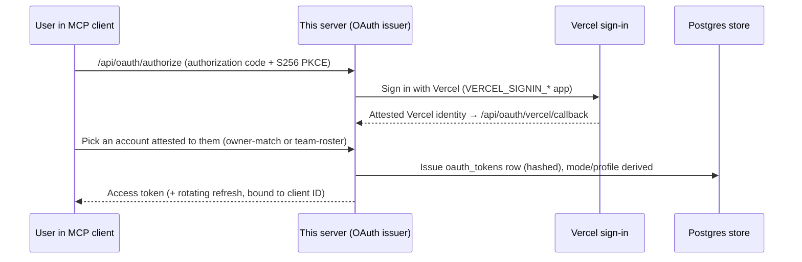

# 02 — Auth and identity

## Public sign-in: Vercel's own, start to finish (SR-1…SR-6, live 2026-11-02)

There is **no password for this server itself** on the public journey.

- **Derived, never selected:** profile is **full for every public
  sign-in**; mode comes from the account's own production switch;
  listing is always the front door. The profile vocabulary survives
  only as development options on the developer route.
- **Clients:** dynamic registration (`api/oauth/register.js`) plus
  explicit public clients (`token_endpoint_auth_method=none`, PKCE
  only); confidential `client_secret_post` clients are retained.
  Client metadata documents (CIMD) are handled in `src/core/cimd.js`;
  Muse's built-in client ID is `muse`.
- **Revocation:** `POST /api/oauth/revoke` (`src/core/oauth-revocation.js`)
  atomically revokes only the calling client's own token row.
- **Read-only** is a switch on the user's own connection
  (`vercel_set_read_only`), never a sign-in class.

## Credential enrollment (getting a Vercel token into the store)

Two doors to the same enrolled account (`vercel_accounts` row):

1. **Door 1 — integration install:** `/api/vercel/integration` installs
   the server's Vercel integration on a team (no token in the user's hands).
2. **Door 2 — token enrollment:** a branch of the sign-in journey
   (`/api/oauth/enroll`). The token is probed read-only against the
   named team/project first; the receipt states declared vs probed
   scope in plain words; a broader-than-named scope needs an explicit
   acknowledgment. The token is stored **encrypted** (see 05) and never
   returned in full.

## Developer-only routes

`/api/dev/authorize` and `/api/dev/enroll` are the only surfaces where
the administrator passphrase (`ADMIN_PASSPHRASE`) survives; every
request proves it, with a database-counted lockout (5 failures / 15 min).

## RTC passes

Separately from OAuth, the owner can issue **RTC passes**
(`rtc_passes` table) for Hub/agent access: a proposal
(`vercel_create_pass` family in `src/tools/pass-*.js`) is reviewed and
applied by the owner; passes carry a per-minute rate limit and, since
R-1W (card: `docs/pr-cards/R-1W.md`), may carry write scope under the same owner review. Pass auth is
enforced atomically across instances in the store.

## Owner administration

Owner actions run on the owner's own connection as tools — apply,
account, pass and reveal families (`src/tools/owner*.js`,
`pass-admin.js`) — including one-time-secret reveal
(`vercel_reveal_one_time_secret`, reveal-once, see 05).
