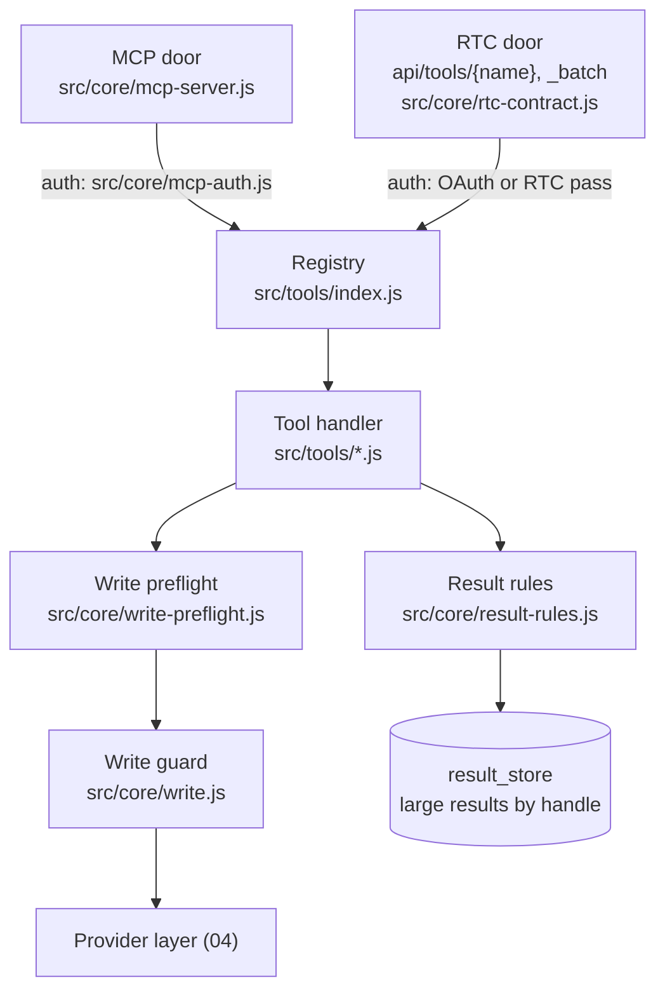

# 03 — Tools and the gateway pattern

## Registry

- `src/tools/index.js` merges every tool family module in `src/tools/`
  (108 modules) through `src/core/registry.js` (`mergeNamespaces`).
- **253 of 254 catalog tools are registered.** The one unbuilt row,
  `vercel_admin_overview`, is closed by owner ruling IN-16 and will
  not be built. The catalog is `docs/TOOL-CATALOG.md`;
  `scripts/check-catalog.mjs` pins catalog ↔ registry agreement.
- Tool names are stable `vercel_*` IDs; the display name ("Vercel by
  Robinson AI Systems") is owner-controlled metadata, not an ID.

## Two dispatch doors, one registry

- **MCP door:** SDK server in `src/core/mcp-server.js`; bearer auth in
  `src/core/mcp-auth.js` resolves the token row → account, mode
  (production switch / read-only), profile.
- **RTC door:** the same handlers over plain HTTPS for the Hub;
  contract and OpenAPI generated from the registry
  (`src/core/rtc-contract.js`, `api/rtc-openapi.js`).

## Guards on every write

- **Profile / mode gate** — a connection's derived profile and the
  account's production switch decide which tools are even listed.
- **Write preflight + guard** (`write-preflight.js`, `write.js`) —
  production writes require `confirm`; spend actions disclose cost
  first and, on delegated connections, park at
  `awaiting_owner_approval` for the owner to apply (owner-apply flow,
  `src/tools/owner-apply.js`, `src/vercel/owner-apply.js`).
- **Change journal + undo** — writes land in `change_log`;
  `vercel_undo_change` (`src/tools/undo.js`) reverses recorded changes
  where the provider allows.
- **Result rules** — oversized results are stored in `result_store`
  and delivered by handle (`/api/results/{handle}`,
  `src/vercel/result-delivery.js`), never dumped raw into the reply.
- **Self-guard** (`src/tools/self-guard.js`) — the server refuses
  operations against its own protected resources outside the rules.
