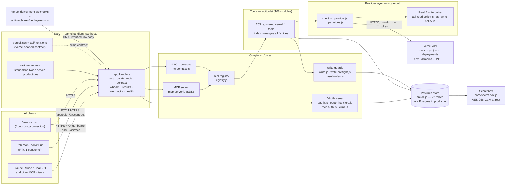

# Relational map — Vercel Unleashed (vercel-mcp)

A readable diagram of how the whole system connects: who calls whom, what
reads or writes what, and what depends on what. This is the map of the
**real, built system** — not the roadmap. When a feature is built or
changed, this map is refreshed in the same change (see `docs/RULES.md`).

- Pointer: `docs/MAP.md`
- Deep verified facts: `docs/ARCHITECTURE.md` · Tool list: `docs/TOOL-CATALOG.md`
- Current heads / live state: `docs/STATUS.md`

## The system in one picture

## Area maps

| File | Area |
|---|---|
| [01-entry-and-clients.md](01-entry-and-clients.md) | Hosts, routes, and who connects |
| [02-auth-and-identity.md](02-auth-and-identity.md) | Sign in with Vercel, OAuth, enrollment, passes |
| [03-tools-and-gateway.md](03-tools-and-gateway.md) | Tool registry, dispatch, write guards |
| [04-vercel-provider.md](04-vercel-provider.md) | The wrapped Vercel API surface |
| [05-storage-and-secrets.md](05-storage-and-secrets.md) | Postgres tables, encryption, retention |
| [06-release-and-operations.md](06-release-and-operations.md) | CI, promotion to `live`, rack production, webhooks |

## Reading conventions

- **calls** — a runtime request from one part to another.
- **reads / writes** — data flow into or out of the store.
- **depends-on** — the part does not work without the other.
- A box named in backticks is a real file or route in this repo.
